# Dashboard walkthrough

The dashboard is a single-page React app served by the same FastAPI app as
the REST API — once built, its static files live at
`src/celery_manager/dashboard/static/` and are mounted at the app's root (`/` standalone, or the prefix you mount it
under; every API and asset URL is relative, so either works). It uses
`HashRouter` rather than browser history routing (the server has no
catch-all fallback route, so a real GET for e.g. `/tasks/abc` would 404
before React ever loads — routing on the URL fragment keeps every deep
link resolving to the same `/` request the server actually serves).

Every screen calls the [REST API](rest-api.md) with `credentials:
"include"` so the session cookie set at login is sent automatically (the
SSE subscription uses `withCredentials: true` for the same reason).

**There is no global `401` interceptor.** `App.tsx` calls `whoami()` exactly
once, on mount, to decide between the login screen and the app; nothing
re-checks after that. So if your session expires while a tab is open, the
next call fails *in place* — the task list shows "Couldn't load tasks.", the
settings screen shows "Your session has expired. Sign in again to save
settings." — and you stay on the screen you were on until you reload. That
is a rough edge, not a design: reloading takes you to the login screen.

## Login

The entry screen, shown when the mount-time `GET /api/whoami` comes back
unauthenticated. A simple username/password form:

- Inputs are locked (`disabled`) while a login request is in flight, so a
  slow network can't produce a double-submit.
- A failed login shows an inline error (`role="alert"`) without leaking
  whether the username or the password was wrong — both `401` cases are a
  single generic message.
- If the mount-time check fails at the network level (server unreachable,
  DNS/CORS issue), you get a distinct **"Connection problem"** screen with a
  **Retry** button *instead of* the login form — a server that isn't
  answering is a different problem from a bad password, and showing a login
  form you cannot possibly submit would be a lie. A network failure during
  an actual login attempt is likewise kept out of the "invalid credentials"
  message.

When your app signs people in (`authenticate_request`, see
[Sign in with your app's users](integrations.md#sign-in-with-your-apps-users)),
the screen adds a **Sign in with <your app>** link under the form, going to
`login_url`; with `local_login_enabled=False` that link is all it shows. Someone
your app signed in but gave no role sees a **No access** screen naming the
account instead of the form, with **Sign out of <your app>** when `logout_url`
is set. For them, the sidebar has no **Change password**, and **Sign out**
goes to `logout_url` (or is absent without one).

On success, the app switches straight to the task list; there's no
separate "remember me" control — the session cookie lasts 7 days by
default (see [Configuration](configuration.md#secret_key-in-production)).

## Navigation

A thin persistent nav bar sits above every authenticated screen: the
brand mark and wordmark on the left, then **Tasks** / **Schedules** /
**Audit Log** / **Workers** / **Settings** (`NavLink`, so the active screen is
highlighted), and a three-way **Auto / Light / Dark** theme control on the
right, and a **Sign out** button. Sign out calls `POST /api/auth/logout`,
which clears the `cm_session` cookie, and returns you to the login screen; while
the request is in flight the button reads "Signing out…", and if it fails an
error message is shown and you stay signed in. Each screen underneath still owns its own page header — the nav bar
deliberately doesn't duplicate per-screen titles or actions.

The brand mark and wordmark are whatever the deployment has been branded
with; see [Appearance and branding](#appearance-and-branding) below.

## Task list

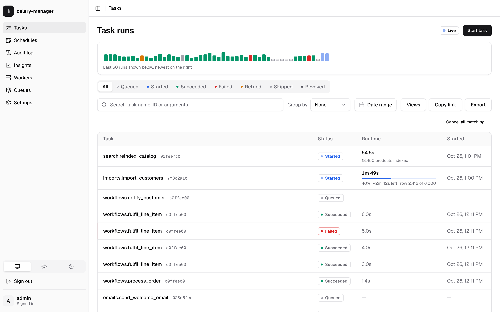{ .cm-shot .cm-only-light }
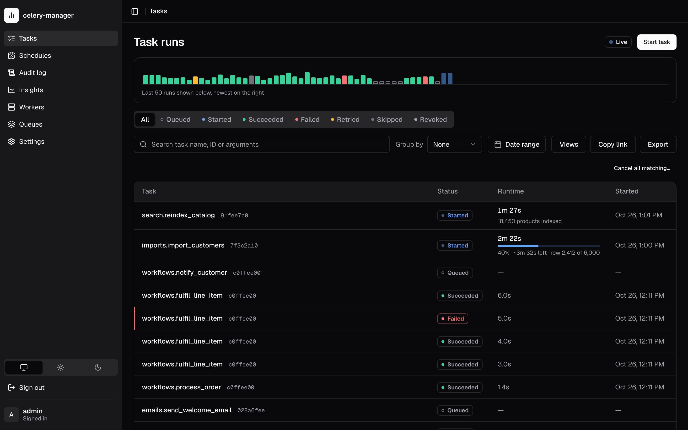{ .cm-shot .cm-only-dark }

The default screen after login (`/`), and the one that gets the most
attention. Filters live in a panel down the left; results, and everything
that describes them, live to the right.

### Filter panel

- **Search** — matches task name, task ID, and argument values, debounced
  so a re-query doesn't fire on every keystroke. It is a substring match
  over the JSON text of `args`/`kwargs`, so searching `alice` finds a run
  whose kwargs contain it; there is no way to express `kwargs.user ==
  "alice"`. See [REST API](rest-api.md#tasks).
- **Status** — `all` plus every status
  (`queued`/`started`/`succeeded`/`failed`/`retried`/`skipped`/`revoked`).
- **Group by** — nothing / status / task name / date. Grouping is done in
  the browser over the rows currently loaded, not across the whole
  history, and the group headers say so ("3 loaded" rather than a total).
- **Date range** — folded away by default, since it is the least-reached
  control. Dates are sent as UTC instants; a picked end date is widened to
  the end of that local day, so your own last day doesn't silently drop
  out of the results.
- **Active filters** appear as removable chips with a **Clear all**, and
  the same list is repeated in the "no matches" empty state — so an empty
  table tells you which filter emptied it instead of leaving you guessing.

Below roughly 1024px the panel collapses behind a **Filters** toggle
carrying a count of what's active. The collapse is `display: none` on the
rail (the markup stays mounted, so your typed filter state survives a
toggle), which is the one hiding technique that also takes the inputs out
of the tab order — a collapsed panel never leaves focusable controls
sitting invisibly behind the table.

### Results

- **"Showing 50 of 1,308 runs"** — the total reflects the filters, so it
  answers "how much is there of *this*", not "how big is the table".
- **Runtime** shows a live-ticking elapsed time for a running task and a
  final duration for a finished one.
- **Progress** — a running task that reports a *known total* via
  [`report_progress()`](progress.md) gets a bar, a percentage, its own
  message, and a projected time remaining. A task that never reports
  progress gets none of that and shows elapsed time only: a bar sitting at
  0% would read as a stuck task, so "not instrumented" never renders as 0%.
  If such a task stops reporting for a while, the row says how long it has
  been quiet and drops the estimate — extrapolating a rate that has visibly
  stopped would keep counting down as if nothing were wrong.

    **Open-ended progress is thinner here than on the detail page.** With no
    total there is no percentage and no bar, and the row shows only the
    task's `progress_message` — the raw count is not rendered in the list,
    and the "no update for …" stalled note is gated on there being a
    percentage, so it doesn't appear either. An open-ended reporter that
    passes no `message` is therefore indistinguishable in the list from one
    reporting nothing at all. The [task detail](#task-detail) page shows the
    count and the quiet time in both cases; use it when you are watching one
    open-ended run.

    A running task's percentage is capped at **99%** until it genuinely
    reports completion — rounding 0.998 up reads as a finished task that is
    somehow still working. The list and the detail page share one derivation
    (`lib/taskProgress`) so they can never quote two different percentages
    for the same run.
- **Bulk retry** — available while the `failed` filter is active. The
  selection is dropped whenever the filter, search, dates, page or mode
  change, and is separately pruned against the visible rows on every
  refresh, so a bulk retry can never act on a row you can no longer see.
- Each row links to that task's detail page.

### Filters live in the URL

The status tab, search, group-by, date range and history-mode page are all
part of the address (`#/?status=failed&q=smtp&from=2026-08-01&group=name`;
history pages add `offset=50`). Reload, back/forward and a link pasted into a
fresh tab all restore the same view. Choosing a tab, date, grouping or page
adds a history entry, so Back undoes it; typing in the search box replaces the
current entry instead, so Back is not a per-keystroke undo. Defaults are left
out of the URL, and unknown values in a hand-edited link are ignored.

**Copy link** copies the current address (it falls back to a hidden-textarea
copy where the clipboard API is unavailable) and confirms with "Link copied".

### Saved views

**Views** in the toolbar saves the current status, search, date range and
grouping under a name; picking one applies it as a single history entry.
Views can be renamed and deleted (deleting asks for confirmation). They are
stored in this browser's `localStorage` only, so they do not follow you to
another browser or profile and are not shared. If the browser refuses to store
them, the menu says so.

### Export

**Export** downloads every run matching the current filters (not just the
loaded page) as CSV or JSON, using `GET /api/tasks/export`. If the result hit
the server's row cap, the page tells you it exported the newest N of M runs.

### Live mode and history mode

The list has two modes, and it always says which one it is in.

**Live** is the default: it updates as runs change (see
[Live updates](#live-updates) below), and **Load more** widens the page up
to the API's 500-row ceiling. Every refresh re-requests the whole span you
have open rather than just the newest page, so a background refresh can
never collapse your loaded rows back to page one.

**History** is for reading further back. You get into it from **Browse all
N runs by page** under the table, or from **Browse older runs** when a live
page has hit the 500-row ceiling. It pages explicitly through the full
filtered total: a ledger above the table reads `Runs 501–550 of 1,308`, and
a pager below it reads `Page 11 of 28` between **← Newer** and **Older →**
buttons (each move scrolls you back to the top of the table). The poll is
switched off while you are in history — which is what makes offset paging
trustworthy, since rows can't shift under you between clicks; SSE events are
ignored in this mode too. The header indicator changes from a pulsing
**Live** dot to a still **Paused** one, and a bar above the table offers
**Back to live**.

### Live updates

The screen opens an SSE connection (`GET /api/stream`) on mount and
refetches when a task event arrives (in live mode only — see above), rather
than patching individual rows from the event payload. A burst of events
becomes at most one refetch a second. Events come from the database, so
writes by the separate events listener and by workers reach the list
within about a second. See
[REST API: how changes reach the stream](rest-api.md#how-changes-reach-the-stream).

The header indicator tells you whether that connection is up. **Live**
(pulsing) means it is. **Connecting** or **Reconnecting** (still) means it
isn't, and while it isn't, the list falls back to polling every 5 seconds;
it also polls while the last refresh failed. When the stream comes back the
list refetches once to catch up and the poll stops. A run's detail page
works the same way for that one run, with a 2-second fallback poll.

A refetch never replaces the rows with a spinner: only the first load shows
a full "Loading tasks…" state. A refetch you *caused* — changing a filter,
or an SSE event arriving — dims the table briefly while the new data is in
flight. The 5-second poll deliberately does not dim, since a table that
flickered every five seconds on its own would be worse than a table that
quietly updates. A failed *background* refresh shows a banner above the
still-visible rows; a failure with no rows behind it shows an error state
with **Try again**.

### Start task

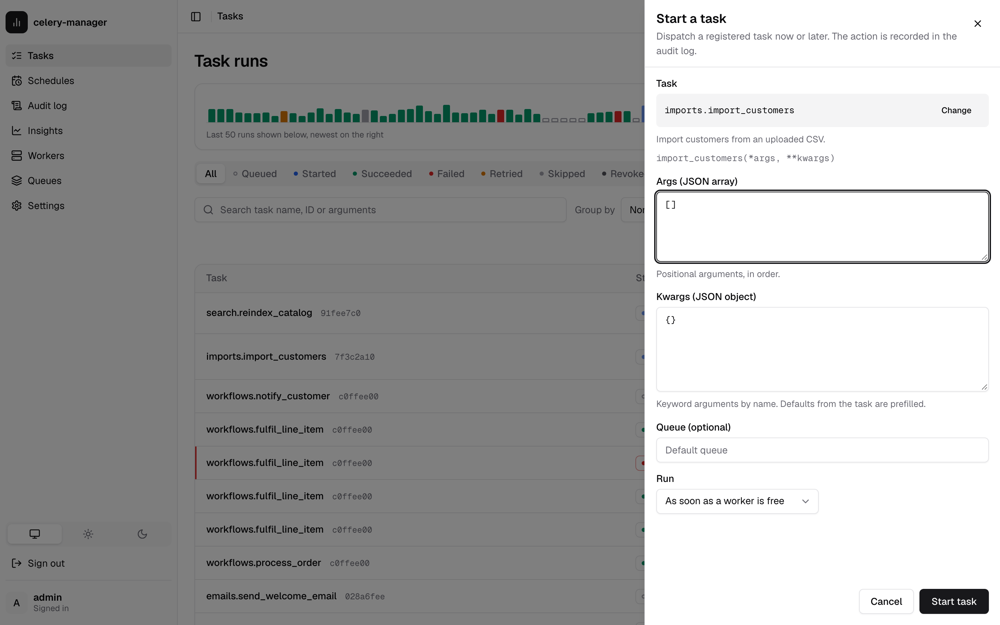{ .cm-shot .cm-only-light }
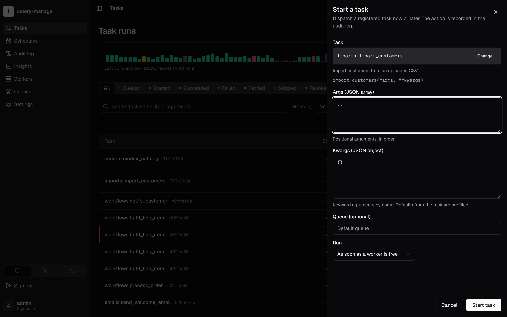{ .cm-shot .cm-only-dark }

The **Start task** button in the page header opens a side sheet (Escape or
**Cancel** closes it and returns focus to the button):

- A searchable picker of the tasks registered on the Celery app
  (`GET /api/tasks/registered`), each with its docstring's first line. If the
  web process hasn't imported your task modules the list may be empty or
  short; type any task name and choose **Use "name"** to dispatch it anyway.
- **Args** (JSON array) and **Kwargs** (JSON object) editors, with the task's
  signature shown and kwargs prefilled from its defaults. Invalid JSON, or the
  wrong shape (an object in Args, an array in Kwargs), shows an error under
  the field and disables the button.
- An optional **Queue**, and **Run** now, after a delay (countdown seconds) or
  at a specific time (ETA, your local time).

Submitting calls `POST /api/tasks/start` (audited) and opens the new run's
page. You can also start tasks over the [REST API](rest-api.md).

## Task detail

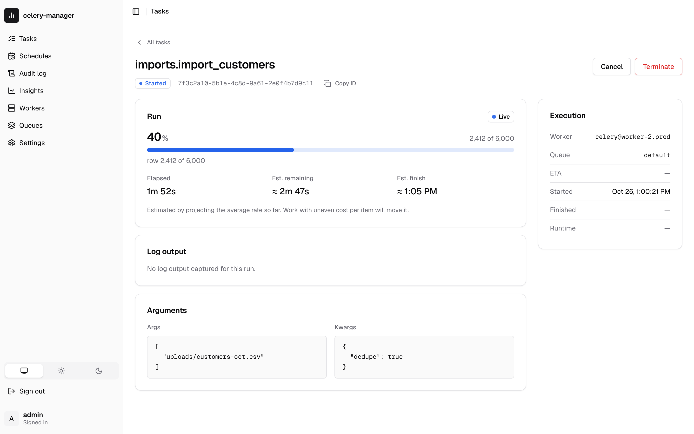{ .cm-shot .cm-only-light }
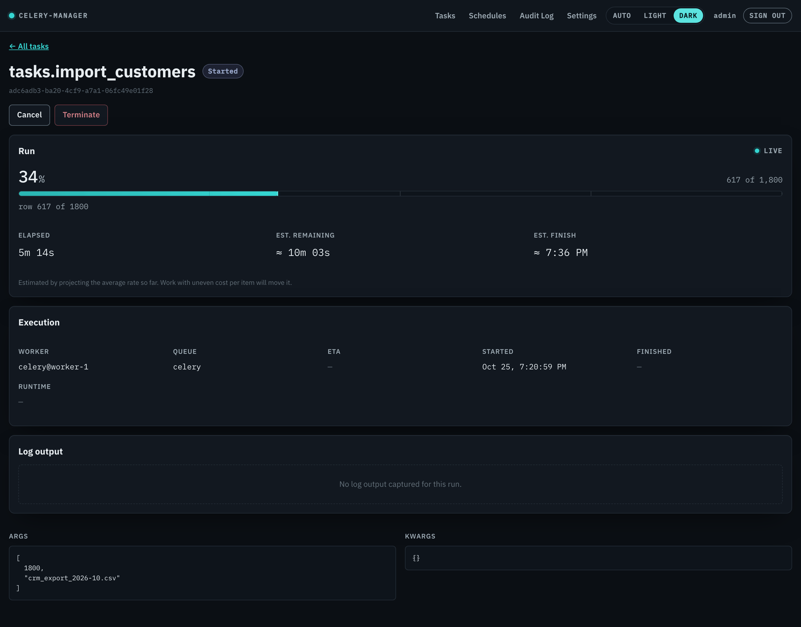{ .cm-shot .cm-only-dark }

`/tasks/:taskId`. Shows one task run in full:

- Status badge, and a **Retry** button shown only when `status ===
  "failed"` — calls `POST /api/tasks/{task_id}/retry` and, on success,
  shows a link to the newly created run (`new_task_id`) rather than
  navigating away, so the user can compare old and new runs side by side
  if they want.
- **Retry with changes**, next to Retry on a failed run: opens the same
  editor as Start task, fixed to this run's task and prefilled with its args
  and kwargs. Submitting sends them in the body of `POST
  /api/tasks/{task_id}/retry`, records the usual retry lineage, notes the
  edit in the audit log (with the new arguments), and opens the new run. If a
  stored value can't be parsed as JSON (older listener-recorded runs keep a
  Python repr) the editor shows it as-is so you can rewrite it.
- Args and kwargs, pretty-printed as JSON (the API returns them as raw
  JSON strings; the page re-parses and re-serializes with indentation for
  display, falling back to the raw string if parsing fails).
- A **"Why it failed"** panel — exception message plus full traceback —
  shown only when the run has a recorded exception.
- A **log output** panel showing everything captured via `@track`'s log
  capture during the run (see [The decorator](decorator.md)), or an empty
  state if the task wasn't decorated or produced no output.
- A **Run** panel: for a running task, the progress bar, percentage,
  message, live elapsed time and an estimated finish; for a finished one,
  the total duration and the start/finish times. The estimate is labelled
  and prefixed as an estimate, and its projected clock time deliberately
  omits seconds — second-level precision on an extrapolation would claim
  accuracy it doesn't have. As on the task list, open-ended progress shows
  a count with no bar, and a run that has gone quiet says so and drops the
  estimate.
- An **Execution** panel: worker, queue, ETA, started, finished, runtime.
  A value that isn't recorded reads as `—` with the reason — "Still
  running", "Hasn't started yet", "No ETA set", or a plain "Not recorded"
  where nothing more specific is knowable — never as a blank cell you have
  to interpret. In practice **ETA always reads "No ETA set"**, because
  nothing in celery-manager currently writes that column; see
  [the REST API note](rest-api.md#datetimes-in-task-responses). Worker and
  queue read "Not recorded" whenever the events listener wasn't running.
- A **Retry lineage** panel, shown only when there is lineage to show: the
  run this one was retried from, and every run retried from it (there can
  be several — retrying a failed run repeatedly is normal). Each is a link,
  so the chain can be walked in both directions.

Panels are ordered for someone debugging at 2am: what broke, how far it
got and how long it took, which worker and queue, whether anyone has
already retried it, then the log, then args/kwargs as the recipe to
reproduce it.

While the run is still *active* — `queued`, `started` or `retried`, not
just running — the page listens on the live stream and refreshes itself
whenever the run changes (progress included). It stops the moment the run
reaches a terminal status, so a finished run's page isn't left listening
forever. While the stream is down it polls every 2 seconds instead. If one of those refreshes fails the page keeps the
data it has and says so ("Live updates paused… Still retrying every 2s.")
rather than blanking.

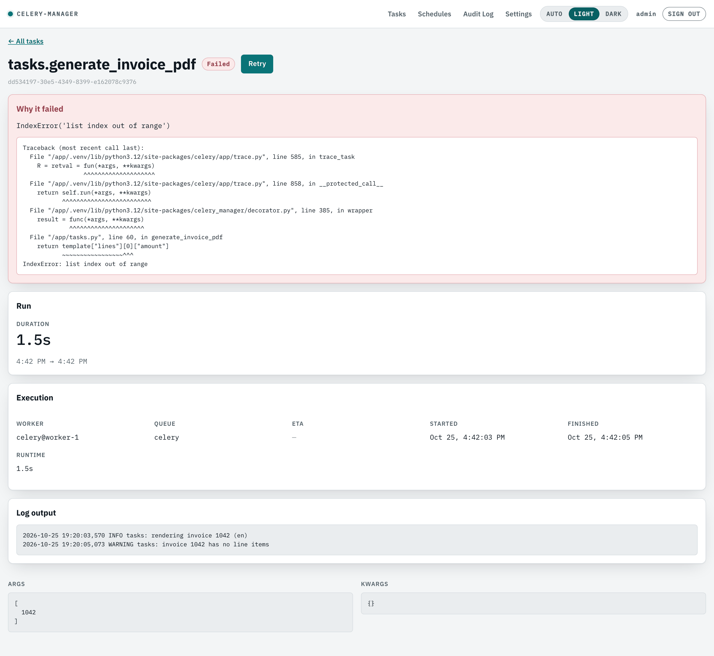{ .cm-shot .cm-only-light }
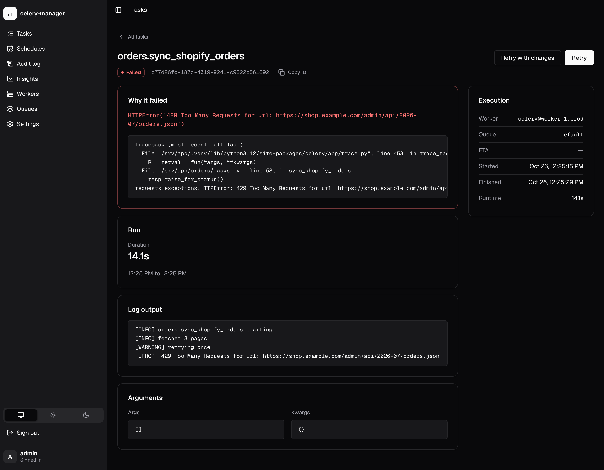{ .cm-shot .cm-only-dark }

### Workflow card

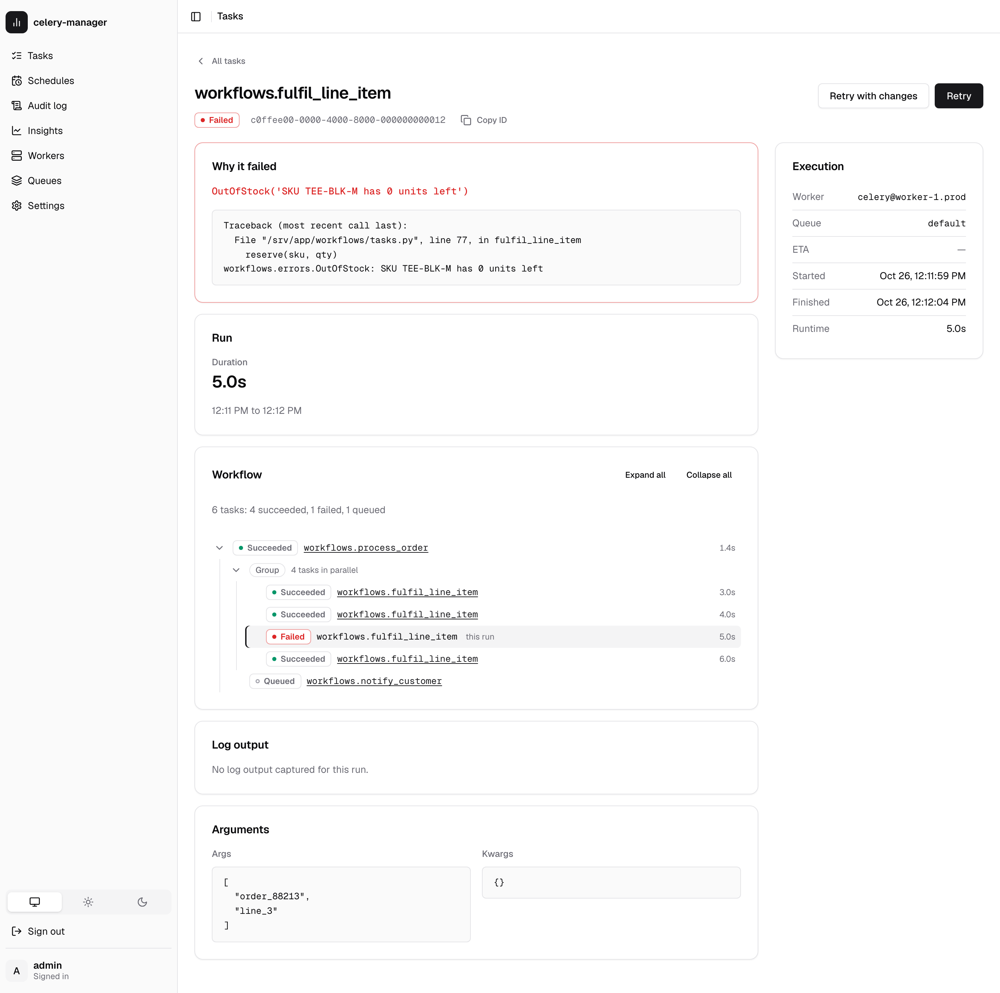{ .cm-shot .cm-only-light }
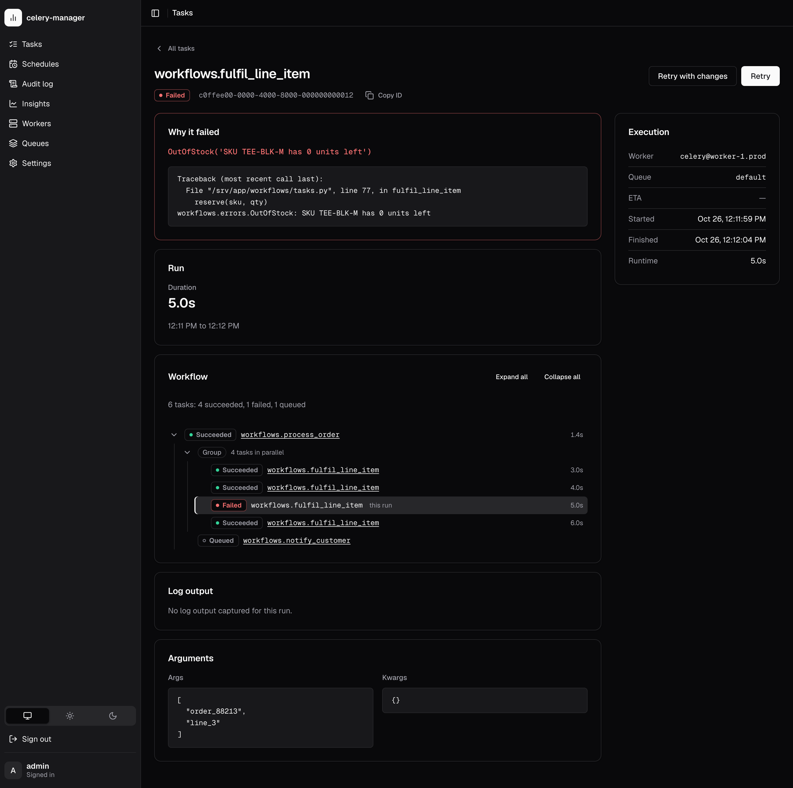{ .cm-shot .cm-only-dark }

When a run belongs to a chain, group or chord, the detail page shows a
**Workflow** card between the run summary and the log. It lays out every run
that shares the same root as an indented tree, exactly as Celery's
`parent_id` links them: each row has a status, the task name (a link to its
own page), and its runtime, and the run you are on is highlighted. Members of
a group are gathered under a **Group** row, and a chord's callback appears
under the parent that Celery recorded for it. A summary line counts tasks by
status ("7 tasks: 5 succeeded, 1 failed, 1 started").

Rows with children have a disclosure button (keyboard operable), and the card
has **Expand all** / **Collapse all**. Trees of more than 30 tasks start
collapsed except for the path to the current run. Very large workflows show
the first 500 runs and say so. Runs that stand alone show no card. The
lineage is captured from Celery events (`task-sent`/`task-received`) and by
`@track`, so it appears for runs seen by either.

## Schedules list

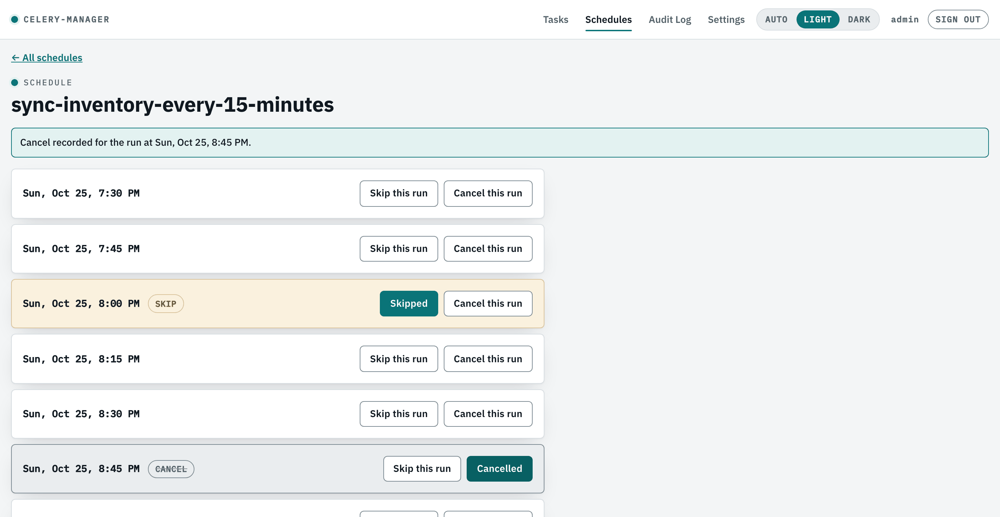{ .cm-shot .cm-only-light }
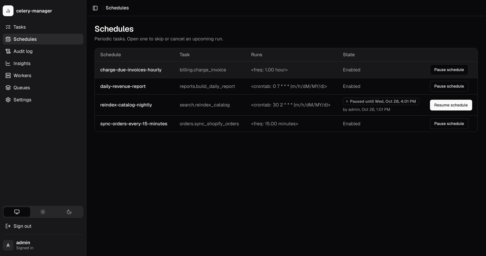{ .cm-shot .cm-only-dark }

`/schedules`, and where the **Schedules** nav link lands. A card per
configured periodic schedule, backed by `GET /api/schedules`: the schedule's
name (a link into its occurrences view), the task it runs, and its
`schedule_spec` as Celery renders it (`<freq: 2.00 hours>`). A schedule with
`enabled: false` carries a **disabled** badge — though nothing sets that flag
today, so in practice every card is enabled.

The list is a pure read of the `periodic_schedules` table, which
`create_app()` syncs from `celery_app.conf.beat_schedule` **once at
startup**. A schedule added to your beat config while the dashboard process
is running will not appear until it restarts. Empty state: "No periodic
schedules configured yet."

A schedule edited from the dashboard shows the edited timing with
"Edited by *user*, *time*" beside it (hover for what the code says). See
[Editing schedules](schedules.md).

## Schedule occurrences (future-schedule view)

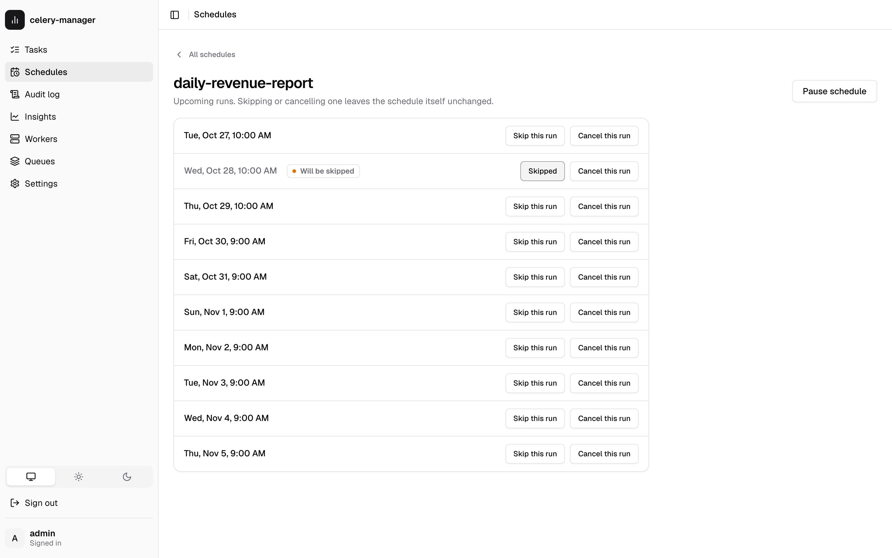{ .cm-shot .cm-only-light }
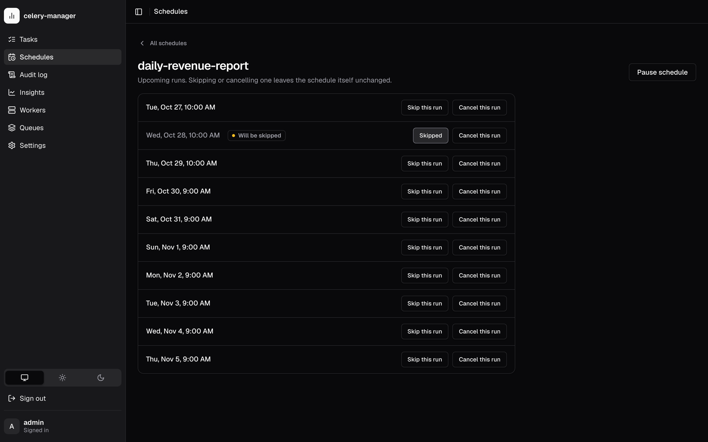{ .cm-shot .cm-only-dark }

`/schedules/:name`. Lists the schedule's next 10 computed occurrences
(`GET /api/schedules/{name}/occurrences`) and lets a user pause one:

- Each row is in one of three states, computed client-side from the API
  response: **pending** (no override yet), **paused** (an override with
  action `skip` or `cancel` exists — both read as "a human has already
  decided this occurrence's fate"), or **resolved** (`consumed: true`,
  meaning the occurrence's scheduled time has actually passed — in
  practice every row this screen shows is still in the future, so this
  state only appears defensively, if the API were to ever return a
  consumed row).
- A **← All schedules** back link returns to the [schedules
  list](#schedules-list), which is where you arrived from.
- **Skip this run** / **Cancel this run** buttons on each non-resolved
  row call `POST /api/schedules/{name}/occurrences/pause` with that row's
  `target_time` and the chosen action. A button already matching the
  row's current action shows as pressed/labeled accordingly (e.g. "Skipped")
  rather than being hidden, so re-clicking the same action or switching to
  the other one both work as an update in place — matching the pause
  endpoint's own update-in-place idempotency (see
  [REST API: occurrence-matching nuances](rest-api.md#occurrence-matching-nuances-worth-knowing)).
  There is no "reschedule" control in the UI, and the API no longer accepts
  that action value either (it returns `422`) — the data model still has the
  column, but no reschedule behavior is implemented.
- A per-row busy/error state means one occurrence's pause request failing
  doesn't block or hide the others; a page-level success notice
  auto-dismisses after 6 seconds.

### Pausing a whole schedule

The **Schedules** list has a **Pause schedule** button on every row, and the
occurrences page has one in its header. It opens a small menu: **Pause
indefinitely**, **For 1 hour**, **Until tomorrow 9:00** (your local time), or
**Until…** with a date and time picker that must be in the future (Escape or a
click outside closes it). **Resume schedule** acts immediately. The list shows
a **Paused indefinitely** or **Paused until \<local time\>** badge with who
paused it and when, and the occurrences page shows a banner with a Resume
button and marks each upcoming run **Will be skipped**, but only the runs
before the end time of a timed pause; later ones run normally. When the time
passes the schedule resumes by itself, and the audit log records an automatic
resume. Per-occurrence skips and cancels keep their own badges and still work.

While paused, every firing is recorded as `skipped`. Limits: resuming does
not run anything immediately and does not catch up on missed firings, since
the next regular beat firing simply runs; and only `@track`-decorated tasks
are enforced. See [REST API: pausing a whole schedule](rest-api.md#pausing-a-whole-schedule).

### Interval schedules

**Interval schedules (`schedule(run_every=…)` / bare seconds / `timedelta`).** Celery beat fires these at "previous fire + interval", and beat's own record of the previous fire isn't visible to the dashboard. celery-manager therefore anchors upcoming occurrences to the schedule's most recent observed run and projects forward by the interval. With beat running `celery_manager.beat:Scheduler`, the anchor is beat's own send time for the last firing (`task_runs.beat_sent_at`), so the next occurrence shown is the one beat will stamp. Without it, the anchor is the newest `task_runs.started_at` with that `schedule_name` (including skipped runs, excluding dashboard retries), which is off by queue latency. Once the schedule has run at least once while celery-manager was recording, the times shown are stable and a skip or cancel matches the real run.

Limitations:
- Before the first observed run, occurrences are only estimates ("now + interval") and shift on every page load. A skip saved then may not match the real fire. Wait for one run before pausing interval schedules.
- Without the stamping scheduler only: ad-hoc calls (`.delay()`/`apply_async` of the same `@track`ed task outside beat) are recorded under the same schedule name and re-anchor the projection, and a task that calls `self.retry()` re-stamps the run's start time.
- Beat restarts: beat may fire an overdue entry immediately when it comes back up after downtime, which is off the projected grid until that run re-anchors it. The stamped occurrence of such a firing is the latest scheduled time that had passed.
- Each firing moves the following interval occurrences by beat's scheduling jitter (milliseconds), so occurrences further ahead are matched within `eta_tolerance_seconds`, not exactly. crontab occurrences match exactly.
- `relative=True` interval schedules aren't modelled.
- The `@track(schedule_name=…)` value must equal the `beat_schedule` key. This was already required for skips to work.

## Workers

{ .cm-shot .cm-only-light }
{ .cm-shot .cm-only-dark }

Every worker that answers the broker, refreshed every 10 seconds while the
tab is visible, with controls to shut a worker down, resize its pool and
change its queues, plus a table for changing task rate limits at runtime.
Runtime rate limits are not saved: they reset when a worker restarts. See
[Workers and rate limits](workers.md).

## Audit log

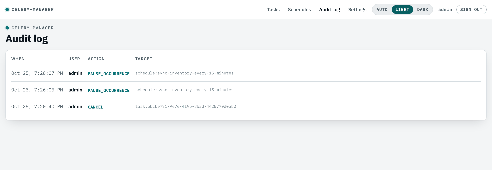{ .cm-shot .cm-only-light }
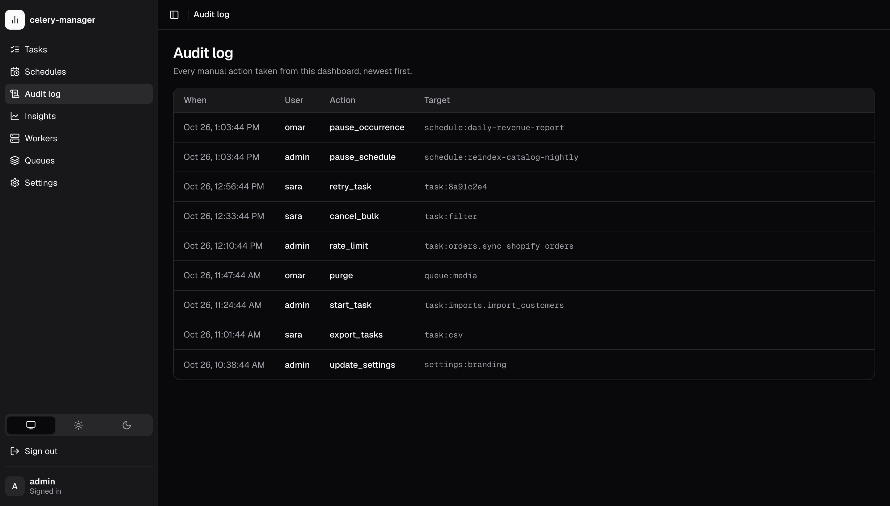{ .cm-shot .cm-only-dark }

`/audit`. A read-only table of every manually-triggered control action, with
**When**, **User**, **Action**, and **Target**
(`{target_type}:{target_id}`, e.g. `task:abc123`) columns, newest first,
backed by `GET /api/audit`.

What you will actually see here, given what the dashboard itself can do:
task retries (single and bulk), per-occurrence schedule pauses, and
[branding changes](#branding--deployment-wide) (one row per changed key).
The API also audits `start` and `cancel`, but **no dashboard control
triggers either** — there is no "run now" and no "cancel" button in the UI
today — so those rows only appear if something calls
`POST /api/tasks/start` or `POST /api/tasks/{id}/cancel` directly. There's no filtering or
pagination control in the UI beyond the API's default 50-row limit
(`limit` is a raw query param on `GET /api/audit` but the screen doesn't
currently expose a control for it). An empty state ("No manual actions
recorded yet.") is shown until the first control action is taken through
the dashboard. A failed load shows the server's own message with a **Try
again** button — the same treatment the task list and both schedule screens
use, so an error screen is never a dead end.

This is the audit trail that answers "who did what, to what, and when" for
anything the dashboard itself performed on a user's behalf — it does not
record automatic system behavior (task status transitions recorded by the
events listener, or automatic skip/cancel outcomes recorded by `@track`);
those show up in the task list and detail screens instead, not here.

## Appearance and branding

`/settings`. Two groups of settings that look similar and are deliberately
scoped very differently — the screen says so on each panel, because users
otherwise assume both are personal.

### Branding — deployment-wide

Stored on the server, so one operator sets it and everyone sees it,
including on the sign-in screen before anyone has logged in.

- **Brand name** — up to 64 characters. Replaces the wordmark in the nav,
  on the sign-in card, on each page's eyebrow, and in the browser tab
  title. Leave it empty to go back to `celery-manager`.
- **Accent colour** — one hex value. The hover, pressed, link and tint
  variants are *derived* from it rather than picked by hand, and the text
  colour on an accent-filled button is chosen by measuring contrast
  against your colour, so a light brand colour gets black text and a dark
  one gets white. Link-coloured text is derived separately, because a
  colour that works as a button fill often fails as small text on a pale
  surface.
- **Logo URL** — an `https://` URL, a `/path` served by this deployment,
  or a `data:image/…` URI. Replaces the brand dot; if the image fails to
  load, the dot comes back rather than leaving a broken-image icon.

A live preview shows the result before you save. Invalid values are
rejected by the API with a message that lands on the offending field (see
[REST API: settings](rest-api.md#settings-branding) for the exact rules and why
they are strict — the accent goes into a CSS custom property and the logo
URL into an ``). **Reset to defaults** clears all three.

Every change is written to the [audit log](#audit-log), one entry per
changed key, with the old and new values. Note there is no role system in
v1: any signed-in user can rebrand the deployment, and the audit trail is
what tells you who did.

### Theme — this browser only

**Auto / Light / Dark**, available both here and in the nav bar. Auto
follows the operating system; Light and Dark override it in both
directions, so choosing Light on a dark-mode machine works. The choice is
kept in the browser's local storage, applies immediately, and is applied
before the page paints — a dark preference doesn't flash a white screen
first. Your colleagues, and your own other browsers, keep their own
choice.
