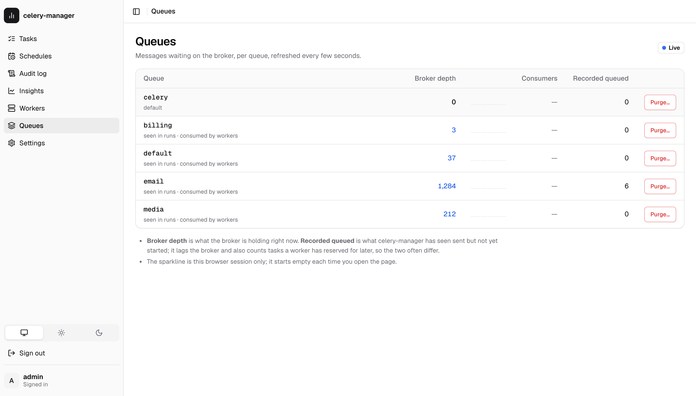
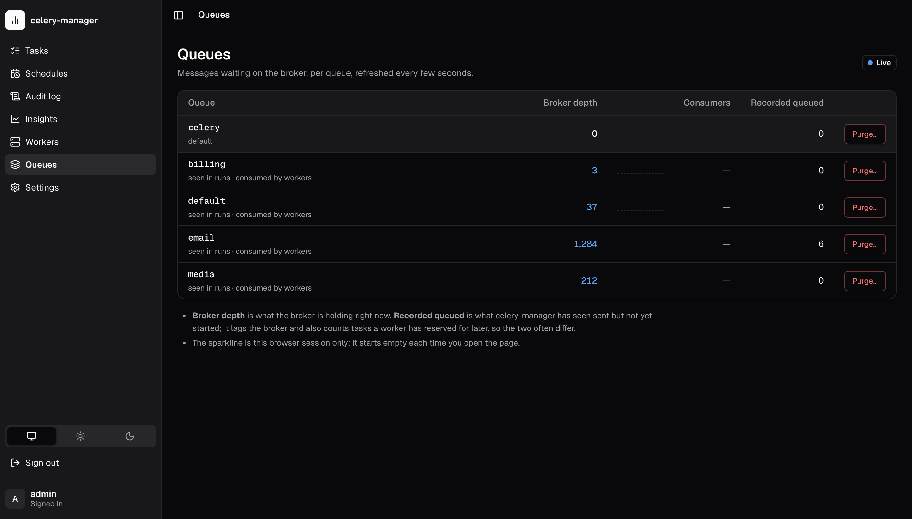

# Queues, purge and bulk cancel

The dashboard's **Queues** page shows how much work is waiting on the broker
for each queue, lets you purge a queue, and the task list can cancel many
runs at once. All three are thin wrappers over Celery/kombu primitives; this
page is about what they actually do, and where they can't see.

## Which queues are listed

{ .cm-shot .cm-only-light }
{ .cm-shot .cm-only-dark }

A queue appears if celery-manager knows its name from any of:

| Source (shown under the name) | Where it comes from |
|---|---|
| default | `celery_app.conf.task_default_queue` (`"celery"` if unset) |
| configured | `celery_app.conf.task_queues` |
| routed | `celery_app.conf.task_routes` — dicts and lists of dicts. Router *functions* are skipped, since reading them would mean calling your code. |
| seen in runs | any `task_runs.queue` value (written by the events listener) |
| consumed by workers | `inspect().active_queues()` from live workers, 1s timeout, cached for 30s |

A queue that none of these mention isn't listed. If your workers consume a
queue nothing else names and no worker answered the inspect, it is missing
until one does; the page says so when no worker replied.

## Two numbers that disagree

Each queue shows two counts:

- **Broker depth**: messages the broker is holding right now, read with a
  passive `queue_declare` on a short-lived connection. Nothing is created
  by looking.
- **Recorded queued**: `task_runs` rows in this queue whose status is still
  `queued`, which is what celery-manager has *seen*.

They routinely differ, and neither is wrong:

- tasks sent while the events listener was down never got a row;
- the listener lags the broker by however long event delivery takes;
- a worker pulls ETA/countdown tasks off the queue right away and holds them
  until they're due. Broker depth drops, but the run is still `queued`;
- runs written by the decorator or a retry don't know their queue until the
  listener fills it in. Those are counted separately ("no recorded queue
  yet") rather than guessed into the default queue.

**Consumers** is the broker's consumer count. Redis, SQS and the other
kombu *virtual* transports always report zero, so on those it is shown as
unknown (`null`), not `0`.

The sparkline is the depth over this browser session only, scaled to the
session's own low and high. It starts empty every time the page opens, and
nothing is stored.

## When the broker can't be asked

`GET /api/queues` always answers `200`. Broker trouble shows up as
`broker.error` and `depth: null` per queue, with the recorded counts still
filled in:

- **unreachable / auth failure**: one connection attempt with a 2s connect
  timeout, no retry loop;
- **slow**: the whole broker round-trip has a 3s deadline. A broker that
  accepts the connection and then hangs can't hang the request; the stuck
  call finishes in a small background pool;
- **`memory://` and `filesystem://`**: reported as unsupported. The
  in-memory transport is private to each process, so the API process would
  only ever see its own empty queues, and the filesystem transport can't
  count the messages in its directory (it would answer `0` for a full one).
  A confident `0` would be a lie, so the page says "queue depth isn't
  available" instead;
- **queue not declared**: depth `0`, `exists: false`. On Redis that just
  means empty (Redis deletes a list when it drains); on RabbitMQ the reason
  says nobody has declared it yet.

The page refreshes every 5 seconds and stops while the browser tab is
hidden.

## Broker health

The **Broker** panel at the top of the Queues page, and `GET /api/broker/health`
(any signed-in user), answer a different question from queue depth: is the
broker itself up, and is it in trouble? What can be shown depends on what the
broker lets a client see.

| Transport | What you get |
|---|---|
| **Redis** (including Sentinel) | Reachable, latency, version, memory used against `maxmemory` (a bar; `maxmemory` of 0 means unlimited, so no bar), eviction policy, connected and blocked clients, evicted keys, refused connections, RDB/AOF status, uptime. |
| **RabbitMQ** (AMQP) | Reachable, latency, product and version. Memory and disk alarms need the RabbitMQ management API, which celery-manager doesn't talk to yet, so the panel says `management: not configured` instead of implying there are none. |
| **Anything else** | Reachable, latency, and "details not available for <transport>". |

**The eviction policy is the one to watch.** A queued task is a key in a Redis
list. If `maxmemory-policy` is anything other than `noeviction`
(`allkeys-lru`, `volatile-ttl`, ...), Redis deletes keys when it runs out of
memory, and it can delete queued tasks, which then never run and leave no
error. The panel shows a warning for any other policy (and for a nonzero
`evicted_keys`). Set `maxmemory-policy noeviction`: a full Redis then refuses
new tasks, which you can see, instead of losing old ones, which you can't.
With no `maxmemory` set nothing is evicted today, and the warning says so.

The check opens one connection with the same 2s connect timeout and 3s
deadline as the queue list and never raises: an unreachable broker is
`reachable: false` with the error. The broker URL is shown with its password
masked, and the same masking is applied to error text. The panel refreshes
with the page. The numbers are also in [`/metrics`](metrics.md) and drive the
`broker_unreachable` and `broker_memory` [alert kinds](alerts.md).

## Purging a queue

`POST /api/queues/{name}/purge` calls `queue_purge` on that one queue and
returns how many messages the broker removed. The dashboard asks you to type
the queue name first. There is no "purge every queue" action.

Only *ready* messages are removed. Messages a worker has already reserved
(prefetched, or ETA/countdown tasks it is holding) are not in the queue any
more and still run.

### What happens to the recorded runs

A purged message never reaches a worker, so no `task-revoked` event will
ever arrive for it, and its run would read `queued` forever. So after a
purge that removed **at least one** message, celery-manager marks every run
recorded as `queued` **in that queue** and **without an ETA** as `revoked`
(with `finished_at` set to now). The audit row records both numbers and the
ids it marked.

This is a best guess, because the broker returns a count, not ids:

- ETA runs are left alone because the worker holds them, so the purge didn't
  touch them;
- if the purge removed nothing, nothing is marked. A stale `queued` row is
  then some other problem, not this purge;
- it corrects itself: if a run marked here does execute after all, its
  succeeded/failed event overwrites `revoked`, because a later terminal
  status wins in the listener.

Errors: `404` if the broker says the queue doesn't exist (RabbitMQ), `503`
if the broker is unreachable, timed out, or is `memory://`. Nothing is
marked or audited on failure.

## Bulk cancel

`POST /api/tasks/cancel-bulk` revokes many runs in one call. It takes either
explicit `task_ids` or a `filter` with the same fields as `GET /api/tasks`
(`status`, `task_name`, `q`, `date_from`, `date_to`), never both. An empty
body is a `400`, not "everything".

- Only runs that can still be stopped are revoked: `queued`, `started` and
  `retried`. Finished ones (`succeeded`, `failed`, `revoked`, `skipped`) are
  counted as `skipped_finished`. Ids with no row are counted as `unknown`
  and not revoked, because bulk actions only touch runs you could see.
- **Cap: 1,000.** More than that is refused with a `400` and nothing is
  revoked. Cancelling an arbitrary first 1,000 of a bigger set isn't a
  scope you chose, so narrow the filter instead.
- `dry_run: true` returns the counts without revoking or auditing. That is
  how the dashboard's "Cancel all matching" shows the number before you
  confirm.
- `terminate: true` also kills runs already executing (the same flag as the
  single cancel). It's off by default and an explicit checkbox in the
  dashboard.
- Revokes go out as `control.revoke([...])` broadcasts of up to 100 ids
  each, followed by one `cancel_bulk` audit row listing every id revoked.

Like the single cancel, this only *asks* workers to revoke. A run's status
changes to `revoked` when the worker's `task-revoked` event comes back
through the listener, not at the moment you click.

In the dashboard, selecting runs on the **Queued**, **Started** or
**Retried** tab offers **Cancel N selected**. **Cancel all matching…**, on
those tabs and on **All**, counts the cancellable runs under the current
filters and asks you to confirm.
