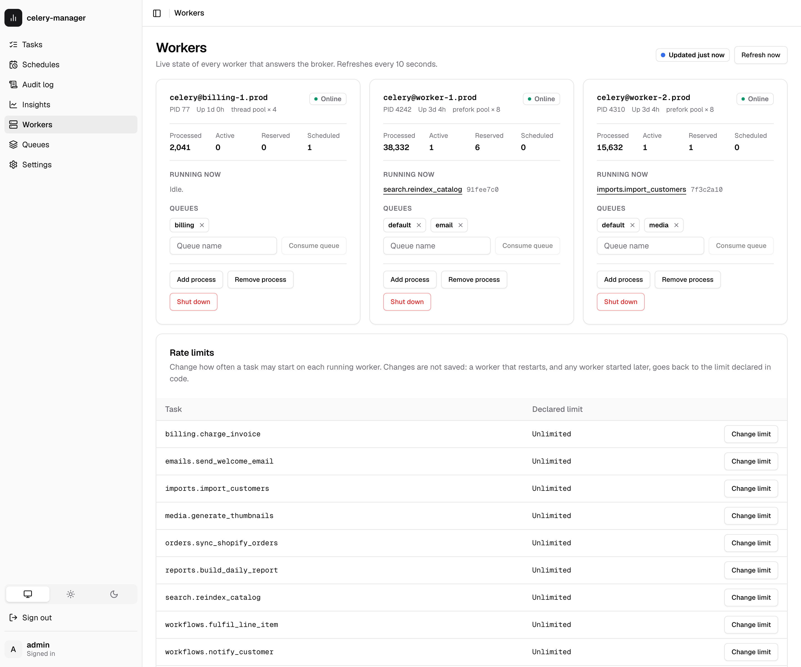
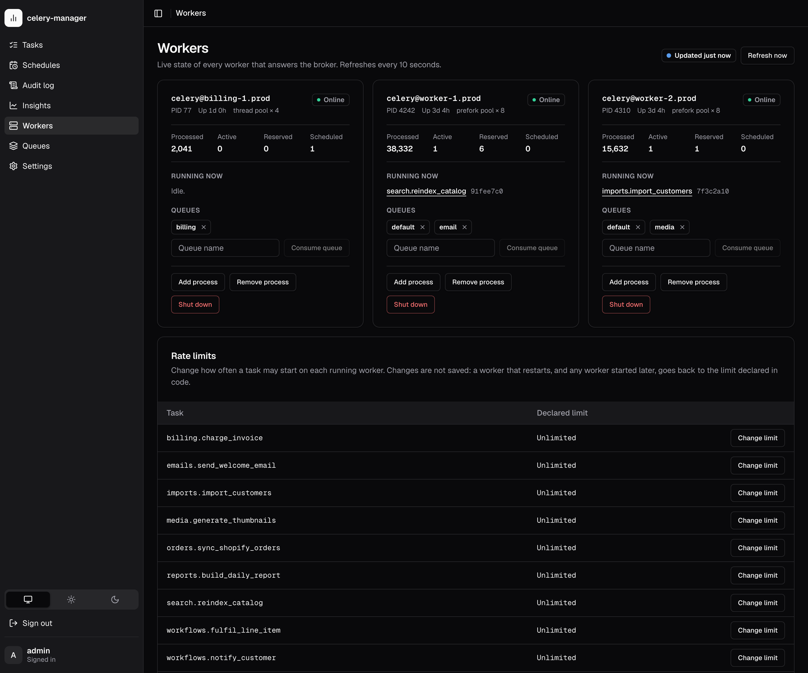

# Workers and rate limits

The **Workers** page shows every Celery worker that answers the broker right
now, and lets you act on them: shut one down, resize its pool, change which
queues it consumes, and change a task's rate limit at runtime.

None of this is stored by celery-manager. Each refresh asks the workers
directly through Celery's remote-control API (`app.control.inspect()` and
friends), so what you see is only as fresh as the last answer, and every
change you make lives in the worker's memory only.

## What you need

- A worker running against **the same broker** as the dashboard's
  `celery_app`.
- Remote control enabled on that worker. It is on by default; the
  `worker_enable_remote_control = False` setting (or a broker without
  broadcast support) turns it off, and then the worker never appears here.

Task events (`-E`) are not needed for this page. They are needed for the
task list, which is fed by the events listener.

## The worker list

{ .cm-shot .cm-only-light }
{ .cm-shot .cm-only-dark }

The page refreshes every 10 seconds while its tab is visible and stops while
the tab is hidden. "Updated 5s ago" shows how old the current answer is.

Each refresh sends one `ping` broadcast and waits up to
[`inspect_timeout_seconds`](configuration.md) (1 s by default) for replies.
It then asks the workers that answered for `stats`, `active`, `reserved`,
`scheduled` and `active_queues`, and stops waiting as soon as all of them have
replied. With no workers a refresh therefore costs about one timeout; with
healthy workers, a little more.

For each worker the card shows:

| Field | Source |
|---|---|
| Online | answered `ping` |
| PID, uptime | `stats` |
| Pool | `stats.pool.implementation`, shortened (`prefork`, `threads`, `gevent`, `solo`, ...), with the live process count (prefork) or the configured concurrency |
| Processed | sum of `stats.total`, the per-task counts since the worker started |
| Active / Reserved / Scheduled | lengths of `active()`, `reserved()` and `scheduled()`. Active tasks link to their run in the task list |
| Queues | `active_queues()` |

**"No workers answered"** means nothing replied within the timeout. Either no
worker is running, it uses a different broker, remote control is off, or the
broker is slow. On a slow or distant broker, raise `inspect_timeout_seconds`.

**"Couldn't reach the Celery broker"** means the broadcast itself failed: the
API answers `503` with the broker's error. If an earlier refresh worked, the
page keeps showing that answer and says how old it is.

## Controls

Every control is a `POST`, requires a signed-in user and writes an
[audit log](rest-api.md#audit-log) row.

| Control | Celery call | Notes |
|---|---|---|
| **Shut down** | `control.shutdown(destination=[worker])` | Asks you to confirm first. A warm shutdown: the worker stops taking new tasks, finishes its running ones, then exits. Celery sends no reply, so the page can only say the command was sent. If a process supervisor (systemd, Kubernetes, supervisord) manages the worker, it will probably start it again. |
| **Add process** / **Remove process** | `control.pool_grow(1)` / `control.pool_shrink(1)` | Only pools that can be resized (prefork, eventlet, gevent) accept these. Other pools reply with an error, which the page shows. |
| **Consume queue** / the **×** on a queue | `control.add_consumer(queue)` / `control.cancel_consumer(queue)` | Lasts until the worker restarts. After a restart its `-Q` option applies again. |

A control reply lists which workers confirmed (`acknowledged`) and which
refused, with the reason (`errors`). A worker that is in neither list didn't
reply within the timeout. The command may still have reached it, so check on
the next refresh.

## Runtime rate limits

The **Rate limits** section lists every task registered on the dashboard's
`celery_app` (Celery's own `celery.*` tasks are left out) with the rate limit
declared in code, `@app.task(rate_limit="10/m")`. **Change limit** sends
`control.rate_limit(task_name, rate)` to every running worker.

A rate is a number of tasks per second, minute or hour: `10/s`, `10/m`,
`100/h`, or a bare number meaning per second. An empty value removes the
limit. The API rejects anything else with `422` before broadcasting.

!!! warning "Runtime rate limits are not saved"
    Each worker keeps the new limit in memory only. When a worker restarts,
    and for any worker started after the change, the limit declared in code
    applies again. To make a limit permanent, set it in code.

Celery has no inspect call that reports the limit a worker is enforcing, so
the table shows the declared default. After a change, the row also shows the
value you applied in this browser session ("Runtime: 30/m").

The list only contains tasks registered in the process that serves the
dashboard. If it is empty or missing tasks, import your task modules (or call
`app.autodiscover_tasks()`) in that process.

## Delayed tasks

A task sent with `countdown=` or `eta=` doesn't wait on the broker. The first
worker to see it takes it off the queue straight away and keeps it in memory
until it is due. Queue depth no longer counts it, and nothing runs it until the
ETA, so the only place it can be seen is the worker holding it.

**Held tasks → Delayed** in the sidebar lists every such task the workers
report (`inspect().scheduled()`), soonest first: task, a countdown to its ETA,
the worker holding it, queue, priority, its arguments and the status
celery-manager has recorded for the run. It refreshes every 5 seconds while the
tab is visible. Like the worker list, it only shows what workers that answer
within `inspect_timeout_seconds` report.

**Arguments are masked.** The list shows each argument's type and the keyword
names (`(str, int) {user_id: int}`), never the values. Operators can tick
**Show argument values** (`?reveal_args=true` on the API); viewers can't.

Below the list, runs celery-manager recorded as `queued` with an ETA still in
the future that no answering worker holds are listed separately. Such a run is
still waiting on the queue (nothing consumes it yet), held by a worker that
didn't answer, or lost. On Redis, check
[Stuck and lost tasks](queues.md#stuck-and-lost-tasks-redis).

### Cancelling

Operators can cancel one delayed task or a selection. This sends the same
`control.revoke` broadcast as the Tasks page's cancel, and also marks the
recorded run `revoked` immediately. A worker only drops a revoked ETA task, and
only then emits `task-revoked`, when the ETA arrives, so without this a task
cancelled today with a week-long countdown would show `queued` for a week. A
cancelled task stays in the list, marked "dropped at the ETA", until then.
Task ids with no recorded run are revoked too. Each cancel writes a `cancel`
(one task) or `cancel_bulk` (several) audit row with `"delayed": true`.

!!! warning "Revokes live in worker memory"
    A worker keeps its list of revoked task ids in memory. If it restarts
    before the ETA, it forgets the cancel, gets the task back from the broker
    and runs it. To make revokes survive restarts, run workers with
    `--statedb` (for example `celery worker --statedb=/var/run/celery/worker.state`).

## API

See [REST API → Workers](rest-api.md#workers) for the endpoints, request
bodies and responses.
